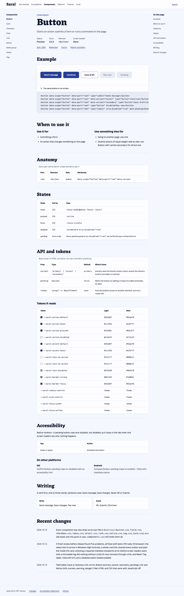
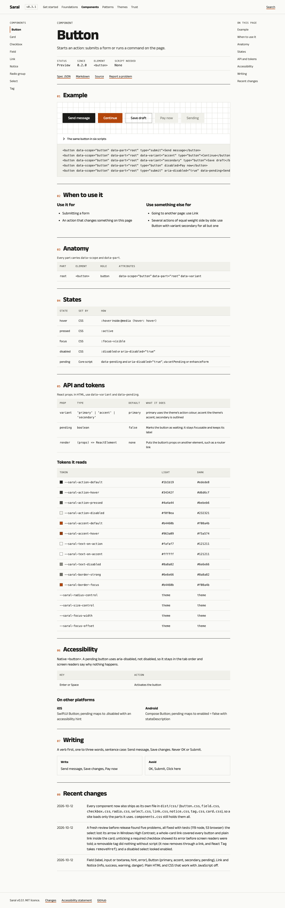

# Website final direction: Neel, with parts of the runners-up

Status: recommendation, waiting for the owner's approval (2026-10-24). Nothing here is decided until the owner says so. On approval a decision record goes in `docs/decisions/` and the website plan is updated.

Fifteen directions were scored on ten criteria: the five on the design canvas, five from ChatGPT and five from Gemini. The top five were critiqued and cut to three, then two. Each of the final two was built as a real Button docs page from `dist/css`, `specs/button.json` and a full, checked set of colour roles, then tested with axe in light and dark at 1280 and 375 pixels, with JavaScript off, in forced colours, and for first-load weight.

**Recommendation: Neel.** It scores highest (41 of 50), it already won the 2026-10-14 pressure test, and its calm, editorial look fits teams who build public services and financial products. The build found one real flaw: in Neel the main button and the accent button are the same indigo, so a page cannot show the two apart. The fix comes from Spec sheet: main actions use Neel's indigo ink, and the bright indigo is kept for the accent and for links. With that change the recommended Button page is axe clean in every theme and width, passes all 26 contrast pairs in light and dark, reads fully with JavaScript off, and loads in 93.5 kB with fonts and no script.

What to look at:

- The canvas, with the moodboard, all fifteen directions and the Final artboard: https://claude.ai/artifact/WiRFKTgTgxsuV76KDHym5R (private to the owner).
- The three Button pages, through `npm run serve`: `/docs/research/website/final/neel-button.html`, `spec-button.html` and `final-button.html`.
- Screenshots: `docs/research/website/final/shots/`.
- The AI references and their full answers: `docs/research/website/external/chatgpt/` and `external/gemini/`. They are AI-generated and not to be shipped.

## How this was done

1. **Asking two other tools.** The same brief was sent word for word to ChatGPT and Gemini in the owner's Chrome. Gemini answered with five directions and ten images in one go. ChatGPT gave five directions in text, six sheets whose direction names did not match its text, and web photos as moodboards; the photos are other people's work and were not saved. Its images were then asked for one direction at a time, as the brief allows. Every answer and image is in `docs/research/website/external/`, each folder with an `index.md` that says it must not be shipped.
2. **Contrast from real hex values.** `website/final/contrast.mjs` checks each direction's stated colours in the pairs it would actually use (text, buttons, links, control edges), with Saral's own contrast maths, against WCAG 2 AA: 4.5 for text, 3 for controls. Where a direction gives no dark palette, its plain inverse is checked and the result says so. Results: `website/final/contrast.json`.
3. **Scoring.** 1 to 5 per criterion, 5 best. Scores for the canvas directions come from their artboards; scores for the AI directions come from their text and images. Contrast is scored from the check: 5 if every pair passes, 4 with one failure, 3 with two, 2 with three, 1 with four or more. Weight is an estimate from the fonts and imagery each direction names, except for the two finalists, which were measured.
4. **Critique** of the top five, with the design-critique method: first impression, usability, hierarchy, consistency, accessibility.
5. **Build and test** of the final two, then of the recommendation: `website/final/palettes.mjs` (full roles, checked with `checks.mjs`), `build-button.mjs` (the pages), `check.mjs` (axe, weight, JavaScript off, forced colours, screenshots).

Limits: the AI directions were scored from pictures and text, not from pages, so their weight and no-JavaScript scores are judgements. The AI tools also did not know Saral's own rules (one accent hue, semantic tokens), which counts against them under "fits Saral's rules". Playwright's own browser is not installed on this machine for the pinned version, so the checks ran in the installed Google Chrome (`SARAL_CHROME=1`); `npm run test:browser` needs `npx playwright install` first.

## Scorecard

Criteria: **Theme** shows theming at a glance. **Trust** for regulated teams. **Dev** developer appeal. **Identity** distinct, and global rather than local. **Scripts** reads well in all six scripts. **Contrast** passes in light and dark (from `contrast.json`). **No JS** works without JavaScript and in forced colours. **Weight** first load at or under 150 kB with fonts. **Rules** fits Saral's rules: semantic tokens, native elements, no em dashes. **Premium** next to Radix, Stripe and GOV.UK.

| Direction | Source | Theme | Trust | Dev | Identity | Scripts | Contrast | No JS | Weight | Rules | Premium | Total |
|---|---|---|---|---|---|---|---|---|---|---|---|---|
| **Neel** | canvas | 3 | 5 | 3 | 3 | 4 | 5 | 5 | 4 | 5 | 4 | **41** |
| **Spec sheet** | canvas | 2 | 4 | 5 | 3 | 2 | 4 | 5 | 4 | 5 | 5 | **39** |
| **Two brands** | canvas | 5 | 3 | 4 | 3 | 3 | 4 | 4 | 3 | 4 | 4 | **37** |
| **Plain sheet** | canvas | 1 | 5 | 3 | 2 | 3 | 4 | 5 | 5 | 5 | 3 | **36** |
| **Editorial Signal** | ChatGPT | 2 | 4 | 3 | 2 | 4 | 2 | 5 | 4 | 5 | 4 | **35** |
| Kolam | canvas | 3 | 3 | 3 | 2 | 4 | 3 | 5 | 4 | 4 | 4 | 35 |
| Modular Architecture | ChatGPT | 4 | 4 | 4 | 2 | 4 | 1 | 4 | 4 | 4 | 3 | 34 |
| Script & Signal | ChatGPT | 4 | 2 | 4 | 4 | 4 | 2 | 4 | 3 | 3 | 4 | 34 |
| Architectural Blueprint | Gemini | 3 | 4 | 5 | 3 | 2 | 2 | 3 | 3 | 4 | 4 | 33 |
| Bare Bones | Gemini | 3 | 2 | 5 | 3 | 2 | 2 | 5 | 5 | 4 | 1 | 32 |
| Living Material | ChatGPT | 3 | 4 | 2 | 3 | 4 | 2 | 3 | 2 | 4 | 4 | 31 |
| The Translator | Gemini | 2 | 2 | 4 | 4 | 5 | 3 | 2 | 3 | 3 | 3 | 31 |
| The Chameleon | Gemini | 5 | 3 | 3 | 2 | 2 | 4 | 2 | 3 | 4 | 3 | 31 |
| Soft Contrast | Gemini | 2 | 5 | 2 | 2 | 3 | 1 | 5 | 4 | 4 | 3 | 31 |
| Adaptive Prism | ChatGPT | 5 | 2 | 4 | 2 | 3 | 2 | 2 | 3 | 2 | 3 | 28 |

Kolam and Editorial Signal tie at 35. The tie goes to the one with more trust for regulated teams, because that is Saral's positioning; Kolam was also withdrawn on 2026-10-13 for announcing India through ornament.

### Why the scores fall where they do

- **Contrast decides more than expected.** Only Neel and The Chameleon pass every pair they were checked on, and The Chameleon states only two colours. Thirteen of the fifteen fail at least one real pair. The AI palettes lean on Tailwind's default colours, and most of those accents fail as text on white or as a button with white text: emerald `#10B981` 2.54:1, aqua `#06B6D4` 2.43:1, signal orange `#F97316` 2.8:1, terracotta `#D97A6B` 3.02:1. Soft Contrast, offered as the most accessible option, fails four of six pairs.
- **Scripts.** Most named type pairings (Geist, Inter, Space Grotesk, Fira, Roboto, Mulish, Atkinson Hyperlegible) have no Devanagari or Arabic, so those scripts fall back to another face beside the headings. Directions that name Noto per script, or use Anek and Eczar, score higher. The Translator scores 5 because scripts are its hero.
- **No JavaScript and forced colours.** Directions whose hero depends on script (a live translator, theme toggles that cross-fade, isometric animation) or on glass and gradients that vanish in forced colours score 2 or 3.
- **Identity.** A direction that looks like someone else scores low: Plain sheet looks like GOV.UK, Spec sheet's Geist is Vercel's own face, Modular Architecture and Adaptive Prism use Tailwind's palette, Chameleon and Two brands hand their identity to other brands.

## Critique of the top five

**Neel.** First look: calm and credible; the eye goes to the serif headline, then the live form, which is the right order. The form proves the product in the hero. Weak spots: theming only appears in a row further down, so "make it yours" is not seen at first glance; the canvas version sets headings in Newsreader, which has no Devanagari (the plan already moves to Eczar); blue is common in software, so the identity rests on type and restraint. Found in the build: the main and accent buttons are the same colour. Contrast passes 9 of 9.

**Spec sheet.** First look: the most exact and premium of the five; the component table on the home page, with element, status, script weight and "works without JS" columns, is the strongest product proof on any home page here. Weak spots: Geist is Vercel's typeface and has no Devanagari or Arabic, so it reads as a Vercel cousin and fails the scripts promise; it is cold for service designers; theming is invisible; its orange on ink in dark mode is 3.14:1. Contrast passes 8 of 9.

**Two brands.** First look: the clearest answer to "make it yours" in two seconds. Weak spots: the identity belongs to the two brands, not to Saral; three font families; the dark brand's input border is 2.82:1; and on the public site the two consumer brands cannot be shown or named, so the proof would need Saral's own themes instead. The centred hero with pill toggles drifts toward a generic product page. Contrast passes 10 of 11.

**Plain sheet.** First look: fast, honest and very clear. Weak spots: it reads as a copy of GOV.UK, which fails "distinct identity"; theming cannot be seen; it does not feel premium next to Radix or Stripe; the inverted link in dark mode is 2.92:1. Contrast passes 8 of 9.

**Editorial Signal (ChatGPT).** First look: clean reading layout, and the token readout beside the hero component is a good idea. Weak spots: ChatGPT itself names the risk, that it looks like dozens of docs sites; its signal orange fails as text (2.68:1) and as a button with white text (2.8:1); the moodboard's buildings and portraits say nothing about Saral. Contrast passes 5 of 8.

**Cut to three: Neel, Spec sheet, Two brands.** Plain sheet and Editorial Signal both look like someone else, which no amount of polish fixes.

**Cut to two: Neel and Spec sheet.** Two brands is a strong section but not a site identity: its look belongs to other brands, and its best idea, one markup in two themes, fits inside either finalist using Saral's own Mor and Kosh. It becomes a home-page section in the recommendation.

## The final two, built

Both pages are the same markup: one long Button page generated from `specs/button.json` (example, the same button in six scripts, when to use it, anatomy, states, API and tokens, accessibility, writing, recent changes from `CHANGELOG.md`), styled by `dist/css/mor.css` and `button.css` plus a full set of the finalist's colour roles. Only the identity layer differs. Fonts are the self-hosted, trimmed files from `website/fonts/`, one per script, loaded by `unicode-range`. Spec sheet uses Saral's Anek in place of Geist, so that it can keep the scripts promise; that change is in its favour.

| Measured on 2026-10-24 | Neel | Spec sheet | Neel, recommended |
|---|---|---|---|
| Colour roles, `checks.mjs` | 26 of 26 pairs, light and dark; one accent hue | 26 of 26; one accent hue | 26 of 26; one accent hue |
| axe, WCAG 2.2 AA tags, 1280 and 375, light and dark | clean | clean | clean |
| axe with the six-scripts panel open | clean | clean | clean |
| First load with fonts | 93.0 kB in 3 requests (fonts 60.6 kB) | 75.8 kB in 2 requests (fonts 42.5 kB) | 93.5 kB in 3 requests |
| JavaScript | 0 kB | 0 kB | 0 kB |
| With all six scripts open | 336.7 kB | 319.4 kB | 337.2 kB |
| Text with JavaScript off | 100% | 100% | 100% |
| Sideways scroll at 375 px | none | none | none |
| Forced colours | every button keeps a visible border | same | same |

Weight is measured uncompressed from the local server, with WOFF fonts; on a server with gzip and WOFF2 both pages would be lighter. The six-scripts panel is closed on load, so the Devanagari, Tamil, Arabic, Thai and Japanese fonts load only when it is opened; Devanagari alone is 166 kB, as the plan already notes.

The first axe run found one serious problem on both pages: the code block and the wide tables scroll sideways but could not be reached by keyboard (`scrollable-region-focusable`). Each scroll box is now focusable and labelled. Looking at the pages at full size also found a missing disclosure arrow on the six-scripts panel and the links row touching the section rule; both are fixed.

Screenshots, all in `docs/research/website/final/shots/`:

| | Neel | Spec sheet | Neel, recommended |
|---|---|---|---|
| 1280, light | `neel-1280-light.png` | `spec-1280-light.png` | `final-1280-light.png` |
| 1280, dark | `neel-1280-dark.png` | `spec-1280-dark.png` | `final-1280-dark.png` |
| 375, light | `neel-375-light.png` | `spec-375-light.png` | `final-375-light.png` |
| Forced colours | `neel-forced.png` | `spec-forced.png` | `final-forced.png` |
| Six scripts open | `neel-scripts.png` | `spec-scripts.png` | `final-scripts.png` |

## Recommendation and why

**Neel, with Spec sheet's ink for main actions.**

- **It fits who Saral is for.** Public services and banks are judged on whether a person finishes the form. Neel reads as a calm, trustworthy service; Spec sheet reads as a tool for developers. Saral needs developers, but it wins on the teams and designers who choose a system for a service.
- **It scores highest, and the scores held when built.** Both finalists came out axe clean, under budget and readable without JavaScript, so the build did not overturn the scorecard. Spec sheet is 17.7 kB lighter because it has no display face; both are far under 150 kB.
- **It keeps the decision of 2026-10-14.** The claim mock, its fonts and its six-script hero already use Neel's look. Switching now would throw that away for a small gain in developer appeal.
- **Its one flaw had a clean fix.** Main actions now use the indigo ink (`#0f172d` light, `#e8ebf2` dark); the bright indigo (`#263d97`, `#93aef8`) is the accent and the link colour. The two button variants can now be told apart in both modes, and all pairs still pass.

The case for Spec sheet, so the owner can weigh it: it is the more premium page at the scale people use most (a component page), it is lighter, and its tables and mono labels look like a system that keeps records. If the owner wants Saral to lead with developers first, it is the better choice, and the recommendation below already borrows its strongest parts.

## What it borrows from the runners-up

| From | What | Where it goes |
|---|---|---|
| Spec sheet | Ink for main actions, so the accent stays rare | `action.*` roles in the new theme |
| Spec sheet | The meta row in mono with small uppercase labels, and table headers to match | Component page header and every table |
| Spec sheet | The component table with element, status, script weight and "works without script" | Home page and the Components overview |
| Two brands | One markup shown in two themes, with the one-line switch | A home-page section, using Mor and Kosh, never consumer brands |
| Editorial Signal | A token readout under the hero component: role, value, ratio | Under the hero form, generated from the theme |
| Plain sheet | Links that look like links, underlined, in one colour | Already in the shell; kept |

The Final artboard on the canvas shows the recommended home page with these changes, beside the real Button page at 1280 and 375 pixels.

## Tokens a new theme needs

The website theme is built as `tokens/themes/neel/` (core, light, dark, policy, `theme.json`), so `npm run build` gates it like Mor and Kosh. It must fill every role in `tokens/roles.json`:

- **Colour, light and dark, 33 roles:** `surface.ground`, `surface.raised`, `surface.sunken`, `surface.inverse`; `text.default`, `text.muted`, `text.quiet`, `text.inverse`, `text.on-action`, `text.on-accent`, `text.disabled`; `border.hairline`, `border.strong`, `border.focus`; `action.default`, `action.hover`, `action.pressed`, `action.disabled`; `accent.default`, `accent.hover`, `accent.subtle`; and `feedback.danger`, `feedback.success`, `feedback.warning`, `feedback.info`, each with `text`, `subtle` and `border`.
- **Shape:** `radius.box` (10px), `radius.control` (8px), `radius.round`.
- **Type:** `font.family.sans` (Anek, then Noto per script).
- **Gates:** all 26 pairs in `tokens/pairs.json` in both modes, and the policy `accentHues: 1`.

The recommended values are in `website/final/palettes.json` under `final`, already checked.

**Two gaps found in Saral.** The pages needed a display face (Eczar) and a code face, and Saral has no role for either, so the pages set them as local variables. The website plan's rule is that a gap the site finds is fixed in Saral: add `font.family.display` and `font.family.mono` to `tokens/roles.json`, with a fallback to `font.family.sans` and the system monospace stack, so Mor and Kosh keep working unchanged.

## After approval

1. A decision record in `docs/decisions/` for the website direction and the action-ink change.
2. Update `docs/spec/2026-10-13-website-plan.md`: the direction section, the borrowed sections, the theme's roles and the two new font roles.
3. Sprint 7, as planned: build `tokens/themes/neel/` from `palettes.json`.
